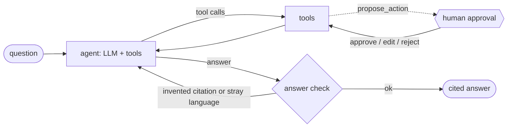

# DC Exception Copilot

An agentic RAG assistant that helps distribution-center (DC) staff resolve warehouse
exceptions: hazmat loading questions, pallet-label problems, shipments at risk, and
safety/handling questions — grounded in real regulations and the DC's own data.

> Runs on SQLite + a local vector store + an LLM API.
> All documents are free and public; downloaded by script, never committed.

## Example questions

- *"Can 6 pallets of aerosol air freshener ship on the same trailer as 2 pallets of bleach?"*
- *"Inbound pallet from supplier S-014 has no SSCC barcode. What do we do?"*
- *"Which outbound shipments for tomorrow contain hazmat, and are they marked correctly?"*
- *"What training does a forklift operator need before driving in the hazmat zone?"*

## Architecture (target)

```
User (Streamlit UI / FastAPI)
        │
   Supervisor agent (LangGraph) ── plans, routes, writes final cited answer
        ├── Knowledge agent  → hybrid RAG over regulations, GS1 standards, SOPs
        ├── Ops data agent   → read-only SQL over the DC database (SQLite)
        ├── Hazmat tool      → deterministic 49 CFR 177.848 segregation check
        └── Action step      → drafts incident report / email, human approves
```

## Corpus

| Source | What | Use |
|---|---|---|
| 29 CFR 1910 (OSHA) via eCFR | Warehouse safety, forklifts, flammables, HazCom/SDS | RAG |
| 49 CFR 172–177 (HMR) via eCFR | Limited quantities, aerosols, loading, segregation | RAG |
| 49 CFR 172.101 | Hazardous Materials Table | Structured lookup |
| GS1 Logistic Label Guideline, General Specs | Pallet labels, SSCC, barcodes | RAG |
| Synthetic SOPs (15) | The fictional DC's procedures, citing the real regulations | RAG |
| Synthetic Safety Data Sheets (16) | 16-section GHS format; transport data from 49 CFR 172.101 | RAG |
| Synthetic incident reports (~200) | Past exceptions: root cause, actions, SOP references | RAG |
| Synthetic warehouse database (SQLite) | SKUs, locations, inventory, receipts, shipments, exceptions | SQL |

Sources are listed in [`config/corpus_sources.yaml`](config/corpus_sources.yaml).

> **Why US regulations?** OSHA and DOT rules are public domain and downloadable by script via
> the eCFR API. The European equivalent (UNECE ADR) blocks automated downloads, so it is left as
> an optional manual add-on.

## The fictional DC

**Meridian Consumer Goods - Columbus DC (`DC-COL1`)** - invented company, people and partners.
43 SKUs from laundry pods to 20 L hydrogen peroxide drums, 8 storage zones (incl. aerosol cage,
flammables room, oxidizer and corrosive bays), 90 days of history up to the simulated
"today" **2026-10-16**, plus 3 days of planned work. The hazmat classifications are real
(checked against the Hazardous Materials Table by a unit test).

Planted scenarios the copilot should find (ids are deterministic):

| Scenario | Where | What a good answer notices |
|---|---|---|
| Oxidizer + corrosive drums on one trailer tomorrow | `SHP-01209` | 177.848 "O" pair (5.1 + 8); split per SOP-HAZ-002 |
| Same chemistries, consumer packs only | `SHP-01210` | Limited quantities: segregation table does not apply |
| Bulk pool shock + TCCA, non-hazmat carrier | `SHP-01211` | Carrier not endorsed **and** SDS says never mix the two |
| 05:30 departure, no trailer, unreliable carrier | `SHP-01212` | At risk per SOP-OUT-002; backup carrier, notify customer |
| Inbound from co-packer with label history | `RCV-00408` | Supplier on enhanced inspection list (SOP-REC-002) |
| Bleach leak near the oxidizer bay | `EXC-00367` | High severity; spill response SOP-HAZ-004 |

## Quickstart

```bash
uv sync                                   # install
cp .env.example .env                      # add your API key
uv run python -m copilot.ingest.download  # fetch corpus (~18 MB) into data/raw/
uv run python -m copilot.synthetic.build_wms  # synthetic DC: data/dc.db, incidents, SDS
uv run python -m copilot.tools.hazmat         # hazmat reference table -> data/reference.db
uv run python -m copilot.ingest.build_chunks  # parse + chunk -> data/processed/chunks.jsonl
uv run python -m copilot.retrieval.naive_chunks   # baseline chunks for comparison
uv run python -m copilot.eval.retrieval_eval      # retrieval metrics -> data/eval/results/
uv run pytest                             # run tests
```

## Project layout

```
config/            corpus sources and settings
data/raw/          downloaded corpus (git-ignored)
data/synthetic/    SOPs (hand-written), SDS + incident reports (generated)
data/dc.db         synthetic warehouse database (git-ignored, regenerate)
src/copilot/       package: ingest/, retrieval/, agents/, tools/, api/
tests/             unit tests + eval suite
notebooks/         walkthrough notebook (imports the modules)
```

## Retrieval

Hybrid search over the chunks: **BM25** keyword search (exact codes like `UN1950`,
`177.848`) + **vector search** in ChromaDB with OpenAI `text-embedding-3-small`
(paraphrases), fused with **Reciprocal Rank Fusion**. Embeddings are cached on disk, so
re-indexing only pays for changed chunks (full corpus is about $0.01).

Evaluated on a 42-question golden set ([data/eval/retrieval_golden.yaml](data/eval/retrieval_golden.yaml))
against a naive LangChain `RecursiveCharacterTextSplitter` baseline:

| Chunking | Search | Hit@1 | Hit@5 | MRR@10 |
|---|---|---|---|---|
| Structured | BM25 | 38% | 69% | 0.52 |
| Structured | Vector | **64%** | **88%** | **0.73** |
| Structured | Hybrid | 62% | 81% | 0.70 |
| Naive | Vector | 60% | 81% | 0.67 |
| Naive | Hybrid | 60% | 86% | 0.70 |

Structure-aware chunks with vector search rank the answer first most often, and also give
exact citations (`29 CFR 1910.178(l)`) that the naive chunks cannot. Remaining misses are
mostly DC procedures crowded out by the large GS1 corpus - addressed in the agent by
routing questions to the right collection with metadata filters. Full report:
[data/eval/results/retrieval.md](data/eval/results/retrieval.md).

## The agent

A LangGraph tool-calling loop around `gpt-5.4-mini` (configurable via `CHAT_MODEL`):



- **Routing in the prompt:** data questions go to SQL, hazmat questions about a shipment
  always go to the deterministic compliance check, procedures to the SOP collection.
- **Citations are verified:** every bracketed citation in the answer must match a citation a
  tool actually returned. If not, the model is told which citations are valid and rewrites
  the answer once; anything still unverified is reported, not hidden.
- **Human in the loop:** emails and tickets go through `propose_action`, which pauses the graph
  (LangGraph `interrupt`) until a person approves, edits or rejects. Sends are simulated and
  written to `data/outbox/`.
- **Prompt-injection hygiene:** document and database text is treated as data, never as
  instructions.

```bash
uv run python -m copilot.agent.cli                       # interactive chat
uv run python -m copilot.agent.cli "Check SHP-01211 before it leaves"
```

## Agent evaluation

36 end-to-end test cases ([data/eval/agent_golden.yaml](data/eval/agent_golden.yaml)): the
planted shipment scenarios, data questions, procedures, regulations, safety data sheets,
questions the agent should decline, manipulation attempts and actions needing approval.
Everything checkable in code is checked in code (tools used, required citations, key facts,
forbidden claims, citation validity, approval flow); an LLM judge (`gpt-5.4`, stronger than
the agent) grades only correctness and completeness against a reference answer. Proposed
actions are always rejected by the evaluator, so nothing is ever sent.

LLM answers vary between runs, so each case runs 3 times:

| | Baseline | After fixes |
|---|---|---|
| Pass rate (all checks) | 64% (1 run) | **87%** (runs: 86%, 86%, 89%) |
| Judge: correct | 83% | 99% |
| Citations valid | 100% | 99% |
| Shipments / safety / SDS / actions | 83% / 100% / 33% / 50% | **100%** each |

What changed: a `read_source` tool (search finds a source, the agent reads it in full
before saying "not found"), a `carrier_performance` tool (KPIs use the official definition
instead of LLM-written SQL), prompt rules for reporting all findings, SQL name matching and
escalation questions. Golden-set references were corrected only where checking the sources
proved the agent right (documented as "label review"). Weakest remaining area: complete
multi-step procedures (63%). Full report: [data/eval/results/agent.md](data/eval/results/agent.md).

```bash
uv run python -m copilot.eval.agent_eval --repeats 3   # local report
uv run python -m copilot.eval.agent_eval --langsmith   # LangSmith experiment
```

## Agent tools

Plain Python functions the agent calls. Safety- and compliance-critical decisions are made by
deterministic, tested code - the LLM chooses a tool and explains the result.

| Tool | What it does |
|---|---|
| `sql_query`, `describe_schema` | Read-only SQL over the warehouse DB: read-only connection + an SQLite authorizer that rejects every non-read operation, one statement per call, row and time limits |
| `lookup_hazmat` | 49 CFR 172.101 Hazardous Materials Table (3,000+ entries) parsed from the regulation into `data/reference.db` |
| `check_shipment_compliance` | 177.848 segregation using the table parsed from the regulation, the limited-quantity exception, the DC's calcium hypochlorite / TCCA rule, and carrier hazmat endorsement |
| `assess_departure_risk` | The at-risk rules of SOP-OUT-002 §3 (trailer assignment, carrier on-time rate, endorsement) |
| `search_documents`, `read_source` | Retrieval with collection filters (vector by default, hybrid for identifiers); read a found source in full |
| `carrier_performance` | On-time rate per carrier using the SOP-OUT-002 definition |

Every tool is traced in LangSmith and returns findings with citations.

## Observability (LangSmith)

Every search is traced to [LangSmith](https://smith.langchain.com) as a retriever run, with
its documents, citations, BM25/vector ranks and the nested embedding call (token usage
recorded). The agent added in later steps is traced the same way.

```bash
# in .env
LANGSMITH_TRACING=true
LANGSMITH_API_KEY=lsv2_...
```

The golden set can also be run as LangSmith **experiments** (one per chunking strategy and
search mode, scored by hit@1, hit@5 and reciprocal rank) to compare configurations in the UI:

```bash
uv run python -m copilot.eval.langsmith_eval --strategies structured --modes vector,hybrid
```

Tracing is off by default and always off in tests.

## Walkthrough notebook

[notebooks/demo.ipynb](notebooks/demo.ipynb) tours each build step with tables and charts
(saved with outputs, so it renders on GitHub). It only imports the project's modules - all
logic lives in tested code under `src/copilot/`.

```bash
uv sync --group notebook
uv run jupyter lab notebooks/demo.ipynb
```

See [ROADMAP.md](ROADMAP.md) for build steps.
